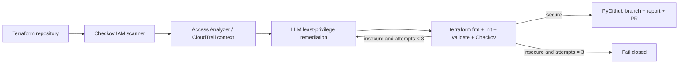

# Autonomous IAM & Cloud Security Posture Agent

Production-oriented LangGraph automation that detects excessive AWS IAM permissions in Terraform, enriches findings with recently used actions, proposes least-privilege code through an LLM, and requires deterministic Terraform and Checkov gates before publishing a pull request.

## Architecture

## Local setup

Requires Python 3.11+, Terraform, and Checkov. Install with `pip install .`. Set `OPENAI_API_KEY` for remediation. For publishing, also set `GITHUB_TOKEN` and `GITHUB_REPOSITORY=owner/repository`. Optional settings are `GITHUB_BASE_BRANCH`, `LLM_MODEL`, and `MAX_VALIDATION_ATTEMPTS`.

Run `iam-security-agent ./dummy_terraform` or `python -m src.main ./dummy_terraform`. Run tests with `pytest`. Build the container with `docker build -t autonomous-iam-security-agent .`.

The GitHub Actions workflow requires the `OPENAI_API_KEY` repository secret; GitHub supplies `GITHUB_TOKEN`. Review generated changes before merging. The agent fails closed when the validation budget is exhausted or required credentials are absent.

## Security controls

- Structured, temperature-zero LLM output is validated before files are written.
- Terraform formatting, initialization, validation, and Checkov are independent gates.
- The workflow requests only contents and pull-request write permissions.
- Publishing uses a new branch and pull request and never writes directly to the default branch.
- The context builder is deterministic and testable, with a clear adapter boundary for approved live Access Analyzer or CloudTrail integrations.

